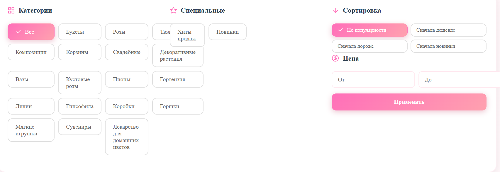
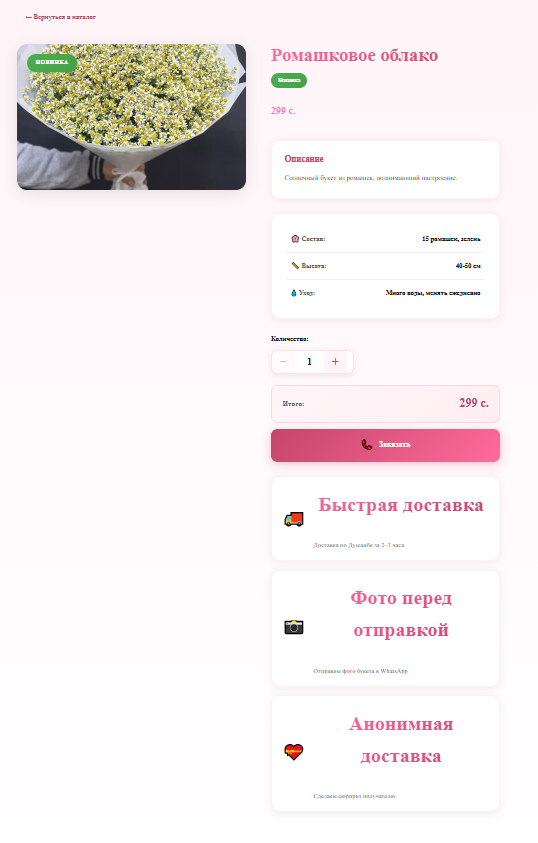
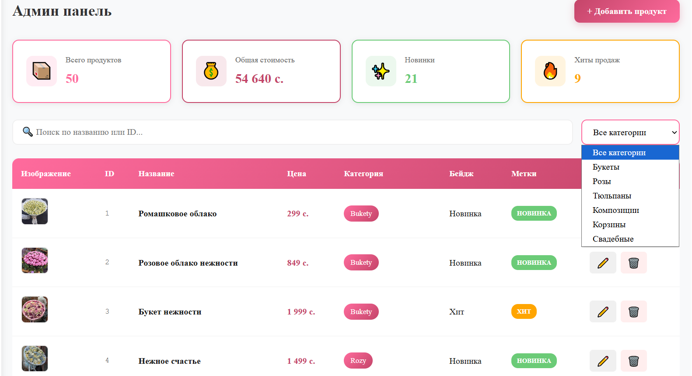

1) Ошибка при переходе в другой раздел страници  нужно показывать с вверху
2) Загрузку нужно сделать красивой а не просто "Загрузка".
3)  http://localhost:8000/catalog   улучши дизайн категории  они конфликтуют. Покажи 12 товаров. если юзер скролит вниз  то другие товары должни появляться.
4) Поставь современние инконки а не мултяшние в всех страницах ALL
5)  http://localhost:8000/product/1  не красивий дизайн улучши.
6) http://localhost:8000/product/1 когда юзер нажимаеть  на кнопку заказать (Создай в админе новий раздель заказы клиентов) по ссылке идеть в ватсап информация о заказе в админку тоже
7)      В все категории не все категории нужно исправить server/data/categories.json
8)  image copy.png, image copy 2.png  нужно показать сколько таких цветов есть в наличии.